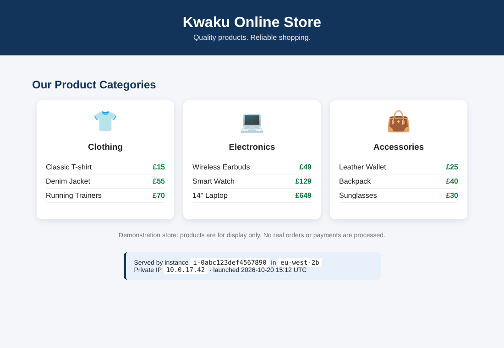

# AWS Highly Available E-Commerce Website | EC2, ALB, Auto Scaling & CloudWatch (AWS CLI)

**Project 1 of my Cloud Engineer portfolio.** A highly available online store on AWS, built and tested entirely with the **AWS CLI**: two web servers in two Availability Zones behind an **Application Load Balancer**, kept healthy and scaled by **EC2 Auto Scaling**, and monitored with **Amazon CloudWatch**.



---

## 1. The business problem

**Kwaku Online Store** sells clothing and electronics. Its website runs on **one server**, which causes three problems:

| Problem | Impact |
|---------|--------|
| **Website downtime**: if the server fails, customers cannot reach the store | Lost sales, unhappy customers |
| **High traffic**: during busy shopping periods the site becomes slow | Abandoned baskets |
| **Manual recovery**: an engineer must restart or replace a failed server by hand | Long outages, out-of-hours call-outs |

**My task as a Cloud Engineer:** design a solution that

1. keeps the website available if one server fails,
2. automatically adds servers when traffic increases,
3. distributes customer traffic across healthy servers,
4. monitors server health and performance, and
5. automatically replaces unhealthy servers.

## 2. Architecture

```
                         Customers (internet)
                                 │  http://kwaku-store-alb-....eu-west-2.elb.amazonaws.com
                                 ▼
                ┌────────────────────────────────────┐
                │  Application Load Balancer         │  kwaku-store-alb-sg: HTTP 80 from anywhere
                │  routes traffic to HEALTHY servers │  health check: GET / every 15 s
                └───────────────┬────────────────────┘
          ┌─────────────────────┴──────────────────────┐
 ┌────────┼──────────── VPC 10.0.0.0/16 (eu-west-2) ───┼────────┐
 │ ┌──────▼──────────────────┐        ┌────────────────▼──────┐ │
 │ │ Availability Zone A     │        │ Availability Zone B   │ │
 │ │ public 10.0.0.0/20      │        │ public 10.0.16.0/20   │ │
 │ │ ┌─────────────────────┐ │        │ ┌───────────────────┐ │ │  kwaku-store-web-sg:
 │ │ │ EC2 server 1        │ │        │ │ EC2 server 2      │ │ │  HTTP 80 ONLY from
 │ │ │ Amazon Linux, NGINX │ │        │ │ Amazon Linux,NGINX│ │ │  the load balancer
 │ │ └─────────────────────┘ │        │ └───────────────────┘ │ │
 │ └─────────────────────────┘        └───────────────────────┘ │
 └────────────────────────────┬─────────────────────────────────┘
                              │
          ┌───────────────────▼────────────────────────────────┐
          │ Auto Scaling group: min 2 · desired 2 · max 4      │
          │  ELB health checks → replace unhealthy servers     │
          │  target tracking → keep average CPU at 60%         │
          ├────────────────────────────────────────────────────┤
          │ CloudWatch: dashboard + HealthyHostCount alarm     │
          └────────────────────────────────────────────────────┘
```

| Service | What it does here |
|---------|-------------------|
| **VPC** | The network: two public subnets in different Availability Zones, an internet gateway |
| **Security groups** | Customers can reach only the load balancer; only the load balancer can reach the servers. No SSH port is open |
| **Launch template** | The recipe for a web server: Amazon Linux 2023, `t3.micro`, IMDSv2, user data that installs NGINX and the store page |
| **Application Load Balancer** | One public address, spreads visitors across healthy servers |
| **Target group** | The list of servers behind the load balancer and their health check |
| **Auto Scaling** | Keeps 2 healthy servers running, replaces failed ones, scales to 4 on high CPU |
| **CloudWatch** | Metrics dashboard, scaling alarms, and an alarm when fewer than 2 servers are healthy |
| **Systems Manager** | Runs commands on the servers (the CPU load test) without SSH or key pairs |

Every page shows **which server and Availability Zone served it**, so load balancing and server replacement are visible in the browser.

## 3. How this proves the problem is solved

| Business requirement | Evidence | How (script) |
|----------------------|----------|--------------|
| Website stays up when a server fails | A server is terminated while the site is probed every 2 s | `08-test-failover.sh` |
| Automatic recovery | Auto Scaling launches a replacement with no human action | `08-test-failover.sh`, scaling activity |
| High availability | Two healthy servers in **separate Availability Zones** | `06`, `07`, evidence/05 |
| Traffic distribution | Requests are answered by both servers | `07-open-store.sh` |
| Scales with demand | CPU load triggers the target tracking policy to add servers | `09-test-scaling.sh cpu` |
| Performance monitoring | Dashboard: healthy hosts, requests, response time, capacity, CPU, errors | `10-create-dashboard.sh` |

---

## 4. Project structure

```
aws-high-availability-store-cli/
├── website/
│   └── user-data.sh              # runs on every new server: installs NGINX, writes the store page
├── iam/
│   └── ec2-trust-policy.json     # lets EC2 use the instance role (Systems Manager access)
├── monitoring/
│   └── dashboard.json            # CloudWatch dashboard definition (6 widgets)
├── scripts/
│   ├── config.sh                 # region, names, sizes (change settings here)
│   ├── 01-create-vpc.sh          # Phase 1: VPC, 2 public subnets, internet gateway, routes
│   ├── 02-create-security-groups.sh   # Phase 2: ALB SG + web SG
│   ├── 03-create-launch-template.sh   # Phase 3: AMI, instance role, launch template
│   ├── 04-create-target-group.sh      # Phase 4: target group + health check
│   ├── 05-create-load-balancer.sh     # Phase 5: ALB + HTTP listener
│   ├── 06-create-auto-scaling-group.sh# Phase 6: ASG (2/2/4) + CPU target tracking
│   ├── 07-open-store.sh               # Phase 7: open the store, show load balancing
│   ├── 08-test-failover.sh            # Phase 8: kill a server, measure availability
│   ├── 09-test-scaling.sh             # Phase 9: manual and real CPU-driven scaling
│   ├── 10-create-dashboard.sh         # Phase 10: CloudWatch dashboard + alarm (+ email)
│   ├── 11-collect-evidence.sh         # Phase 11: save proof to evidence/
│   └── 99-cleanup.sh                  # Phase 12: delete everything
├── docs/
│   ├── testing.md               # test plan and results template
│   ├── troubleshooting.md
│   └── images/store-preview.png
└── screenshots/                  # put your console screenshots here
```

## 5. Prerequisites

| You need | Notes |
|----------|-------|
| An AWS account | Permissions for VPC, EC2, Elastic Load Balancing, Auto Scaling, IAM, CloudWatch, SNS, Systems Manager |
| **AWS CloudShell** (recommended) | Open the AWS Console in **Europe (London) eu-west-2** and click the CloudShell icon. AWS CLI v2, git, python3 and curl are installed |
| or your own terminal | AWS CLI v2 configured (`aws configure`), git, python3, curl |

```bash
git clone https://github.com/KwakuAdae/aws-high-availability-store-cli.git
cd aws-high-availability-store-cli
aws sts get-caller-identity
```

> **Cost warning:** this lab is not entirely free. The load balancer, EC2 instances and public IPv4 addresses are charged by the hour (about **$0.06 per hour** in total, see section 9). There is **no NAT gateway**. Run Phase 12 when you finish.

## Quick start

```bash
./scripts/01-create-vpc.sh
./scripts/02-create-security-groups.sh
./scripts/03-create-launch-template.sh
./scripts/04-create-target-group.sh
./scripts/05-create-load-balancer.sh          # ~3 min
./scripts/06-create-auto-scaling-group.sh     # ~3-5 min
./scripts/07-open-store.sh                    # prints your store URL
```

---

## 6. Step-by-step implementation (AWS CLI)

### Phase 1: Create the VPC

```bash
./scripts/01-create-vpc.sh
```

| Setting | Value |
|---------|-------|
| VPC | `kwaku-store-vpc`, `10.0.0.0/16`, DNS resolution + DNS hostnames enabled |
| Availability Zones | 2 (the first two available in eu-west-2) |
| Public subnets | `10.0.0.0/20` (AZ A), `10.0.16.0/20` (AZ B), auto-assign public IPv4 |
| Private subnets | 0 |
| NAT gateways | None (saves about $1 per day) |
| Route table | `0.0.0.0/0 → internet gateway`, associated with both subnets |

```bash
aws ec2 create-vpc --cidr-block 10.0.0.0/16 \
  --tag-specifications 'ResourceType=vpc,Tags=[{Key=Name,Value=kwaku-store-vpc},{Key=Project,Value=kwaku-store}]'
aws ec2 create-subnet --vpc-id <vpc> --cidr-block 10.0.0.0/20 --availability-zone eu-west-2a ...
aws ec2 create-internet-gateway ... && aws ec2 attach-internet-gateway ...
aws ec2 create-route --route-table-id <rt> --destination-cidr-block 0.0.0.0/0 --gateway-id <igw>
```

The script prints the subnets and routes so you can verify: two subnets in different AZs, and a `0.0.0.0/0` route to the internet gateway. All IDs are saved in `.lab-env` for the next phases.

### Phase 2: Create the security groups

```bash
./scripts/02-create-security-groups.sh
```

| Security group | Inbound rule | Why |
|----------------|--------------|-----|
| `kwaku-store-alb-sg` | HTTP 80 from `0.0.0.0/0` | Customers reach the load balancer |
| `kwaku-store-web-sg` | HTTP 80 **from `kwaku-store-alb-sg` only** | Servers cannot be reached directly from the internet |

```bash
aws ec2 authorize-security-group-ingress --group-id <web-sg> \
  --ip-permissions 'IpProtocol=tcp,FromPort=80,ToPort=80,UserIdGroupPairs=[{GroupId=<alb-sg>}]'
```

Referencing a **security group** instead of an IP range means the rule keeps working whatever IP addresses the load balancer uses. **SSH port 22 is not opened at all.**

### Phase 3: Create the launch template

```bash
./scripts/03-create-launch-template.sh
```

| Setting | Value |
|---------|-------|
| Name | `kwaku-store-template` |
| AMI | Latest **Amazon Linux 2023**, from the public SSM parameter `/aws/service/ami-amazon-linux-latest/al2023-ami-kernel-default-x86_64` |
| Instance type | `t3.micro` |
| Key pair | None |
| Network interface | Device 0, auto-assign public IP, security group `kwaku-store-web-sg`, no subnet (the ASG picks it) |
| Metadata | **IMDSv2 required** |
| Instance profile | `kwaku-store-ec2-role` with `AmazonSSMManagedInstanceCore` (run commands without SSH) |
| User data | [`website/user-data.sh`](website/user-data.sh) |

**What the user data does:** on every new server it installs NGINX, asks the instance metadata service (with an IMDSv2 token) for the instance ID, Availability Zone and private IP, writes the store page and a small `/server.json`, and starts NGINX.

### Phase 4: Create the target group

```bash
./scripts/04-create-target-group.sh
```

| Setting | Value |
|---------|-------|
| Name | `kwaku-store-targets` |
| Protocol / port | HTTP 80, HTTP1, IPv4, target type `instance` |
| Health check | HTTP `GET /`, expect `200`, every 15 s, 2 checks to change state |
| Deregistration delay | 30 s (finish in-flight requests when a server leaves) |

No servers are registered by hand. The Auto Scaling group does it in Phase 6.

### Phase 5: Create the Application Load Balancer

```bash
./scripts/05-create-load-balancer.sh
```

```bash
aws elbv2 create-load-balancer --name kwaku-store-alb --type application --scheme internet-facing \
  --subnets <subnet-a> <subnet-b> --security-groups <alb-sg>
aws elbv2 create-listener --load-balancer-arn <alb> --protocol HTTP --port 80 \
  --default-actions Type=forward,TargetGroupArn=<tg>
aws elbv2 wait load-balancer-available --load-balancer-arns <alb>
```

At this stage the load balancer exists, but the site returns **503** because no servers are attached yet.

### Phase 6: Create the Auto Scaling group

```bash
./scripts/06-create-auto-scaling-group.sh
```

```bash
aws autoscaling create-auto-scaling-group --auto-scaling-group-name kwaku-store-asg \
  --launch-template 'LaunchTemplateId=<lt>,Version=$Latest' \
  --vpc-zone-identifier "<subnet-a>,<subnet-b>" \
  --target-group-arns <tg> \
  --health-check-type ELB --health-check-grace-period 300 \
  --min-size 2 --desired-capacity 2 --max-size 4

aws autoscaling put-scaling-policy --auto-scaling-group-name kwaku-store-asg \
  --policy-name kwaku-store-cpu-60 --policy-type TargetTrackingScaling --estimated-instance-warmup 300 \
  --target-tracking-configuration '{"PredefinedMetricSpecification":{"PredefinedMetricType":"ASGAverageCPUUtilization"},"TargetValue":60}'
```

| Setting | Value | Meaning |
|---------|-------|---------|
| Desired / min / max | 2 / 2 / 4 | Normally 2 servers, never fewer, up to 4 under load |
| Subnets | both public subnets | Auto Scaling spreads servers across both AZs |
| Health check type | **ELB**, grace 300 s | A server the load balancer marks unhealthy is replaced (not only a server that stops) |
| Scaling policy | Target tracking, average CPU **60%**, warmup 300 s | AWS creates two CloudWatch alarms that add or remove servers |
| Group metrics | enabled, 1 minute | `GroupDesiredCapacity`, `GroupInServiceInstances`... in CloudWatch |

The script waits until **2 targets are healthy** (about 3-5 minutes), then shows them.

### Phase 7: Open the online store

```bash
./scripts/07-open-store.sh
```

Example output:

```
▶ 20 requests: which server answered each one?
    10 i-0a1b2c3d4e5f60789 eu-west-2a
    10 i-0f9e8d7c6b5a40321 eu-west-2b
```

Open the printed `http://kwaku-store-alb-....eu-west-2.elb.amazonaws.com` (use **http://**, there is no certificate) and refresh: the **Served by** box switches between the two servers.

### Phase 8: Test high availability (simulate a server failure)

This is the most important test: it proves the business problem is solved.

```bash
./scripts/08-test-failover.sh
```

1. Terminates one web server (`aws ec2 terminate-instances`). The Auto Scaling group is **not** changed.
2. Calls the website every 2 seconds the whole time and counts successes.
3. Shows the recovery: the load balancer stops sending traffic to the dead server, Auto Scaling sees the group is below 2 and launches a replacement, and the new server passes its health checks.

Example output (your timings and counts will differ):

```
   +20s   website ok=10  failed=0 | ASG instances=2 | healthy targets=1
   +140s  website ok=66  failed=0 | ASG instances=2 | healthy targets=1
   +260s  website ok=121 failed=0 | ASG instances=2 | healthy targets=2
✅ Result: 121/121 website checks succeeded while a server was lost and replaced.
```

```
Failure recovery process
  One EC2 instance fails
        ↓
  Health checks detect the failure → load balancer stops routing to it
        ↓
  Auto Scaling launches a new server (from the launch template)
        ↓
  Two healthy servers restored
```

There may be a brief error while the health checks notice the failure. This lab demonstrates **improved availability**, not a guarantee of zero downtime.

### Phase 9: Test scaling

**Capacity management (manual):**

```bash
./scripts/09-test-scaling.sh manual      # desired 2 → 3, wait for 3 healthy, back to 2
```

**Automatic scaling on real CPU load:**

```bash
./scripts/09-test-scaling.sh cpu 12      # load every CPU for 12 minutes
```

This uses **Systems Manager Run Command** (no SSH, no key pair) to start CPU-burning processes on every server. Average CPU rises above 60%, the target tracking **AlarmHigh** fires after about 3 minutes, and Auto Scaling raises the desired capacity (up to 4). Example output:

```
   14:02  avg CPU: 4.1%    desired capacity: 2
   14:05  avg CPU: 99.6%   desired capacity: 2
   14:07  avg CPU: 99.8%   desired capacity: 4
```

When the load stops, the **AlarmLow** alarm scales back in to 2 (slower on purpose: about 15 minutes).

```bash
./scripts/09-test-scaling.sh status      # capacity, alarms, recent scaling activity
```

### Phase 10: Monitor with CloudWatch

```bash
ALERT_EMAIL=you@example.com ./scripts/10-create-dashboard.sh    # ALERT_EMAIL is optional
```

Creates the dashboard **`kwaku-store-monitoring`** from [`monitoring/dashboard.json`](monitoring/dashboard.json):

| Widget | Namespace / metric |
|--------|--------------------|
| Healthy / unhealthy servers | `AWS/ApplicationELB` HealthyHostCount, UnHealthyHostCount |
| Requests per minute | `AWS/ApplicationELB` RequestCount |
| Response time (avg, p95) | `AWS/ApplicationELB` TargetResponseTime |
| Server capacity | `AWS/AutoScaling` GroupDesiredCapacity, GroupInServiceInstances, GroupMaxSize |
| Average CPU vs 60% target | `AWS/EC2` CPUUtilization by AutoScalingGroupName |
| Errors | `AWS/ApplicationELB` HTTPCode_ELB_5XX_Count, HTTPCode_Target_5XX_Count |

It also creates the alarm **`kwaku-store-unhealthy-hosts`** (fewer than 2 healthy servers for 2 minutes). With `ALERT_EMAIL`, it emails you through an SNS topic: confirm the subscription email first. Run Phase 8 again and watch the alarm and the dashboard react.

**Why this matters to the business:** monitoring shows unhealthy servers, slow responses and capacity changes before customers complain, and tells the business when more capacity is needed.

### Phase 11: Collect evidence for GitHub

```bash
./scripts/11-collect-evidence.sh
```

Saves the state of every component to `evidence/` (subnets, security groups, launch template, load balancer, target health, Auto Scaling group, scaling activity, alarms, and 20 load-balanced responses). No credentials are written.

Also take screenshots and save them in `screenshots/`:

- the store in the browser (refresh to show both servers)
- the VPC and two public subnets, and both security groups
- the launch template and the Application Load Balancer
- the target group with two healthy targets
- Auto Scaling **Activity** showing the replacement of the terminated server
- the CloudWatch dashboard

Do not include account IDs, access keys or other sensitive details.

### Phase 12: Delete all AWS resources

```bash
./scripts/99-cleanup.sh
```

Deletes everything in dependency order: Auto Scaling group (scale to 0, terminate servers) → load balancer → target group → launch template → dashboard, alarm, SNS topic → instance role → security groups → route table, subnets, internet gateway → VPC. Resources are found by name and tag, so it is safe to run again.

Finally, check **EC2 → Instances**, **EC2 → Load Balancers**, **VPC**, and **Billing and Cost Management**.

---

## 7. Limitations (this is a learning environment)

This is not a production-ready e-commerce system. Production would normally add:

- **HTTPS** with an ACM certificate on the load balancer (and HTTP → HTTPS redirect)
- Servers in **private subnets** with a NAT gateway or VPC endpoints, and only the load balancer public
- **AWS WAF** in front of the load balancer
- A real application and **database** (for example Amazon RDS Multi-AZ) and session storage
- Infrastructure as code (Terraform or CloudFormation) and a CI/CD pipeline
- Centralised logs (ALB access logs, CloudWatch agent)

## 8. Skills demonstrated

- AWS EC2 and VPC configuration
- High availability architecture across Availability Zones
- Elastic Load Balancing (ALB, listeners, target groups, health checks)
- EC2 Auto Scaling (launch templates, ELB health checks, target tracking)
- Amazon CloudWatch (dashboards, alarms, SNS notifications)
- Security group design (least privilege, no SSH, IMDSv2)
- AWS Systems Manager Run Command
- AWS CLI automation and scripting
- Cloud infrastructure troubleshooting
- Business continuity and disaster recovery fundamentals

## 9. Cost

| Resource | Approximate price (eu-west-2) |
|----------|-------------------------------|
| Application Load Balancer | ~$0.025 per hour + LCU usage |
| 2 × t3.micro | ~$0.011 per hour each (free tier eligible in the first year) |
| Public IPv4 addresses (2 servers + load balancer nodes) | $0.005 per hour each |
| CloudWatch dashboard, alarms | Dashboards: 3 free, then $3/month; a few alarms: cents |
| Data transfer | Negligible for this lab |

About **$0.06-0.08 per hour**, so a 3-hour session costs about 20-25 cents. Always run Phase 12.

## 10. What you can tell recruiters

> **Project: Highly Available E-Commerce Website on AWS**
>
> **Business problem:** A growing online retail business needed a more reliable hosting solution to reduce website downtime, improve scalability, and minimise manual server recovery.
>
> **Solution:** Designed and deployed a highly available web hosting architecture using Amazon EC2, Application Load Balancer, Auto Scaling, VPC, security groups and Amazon CloudWatch, built and tested entirely with the AWS CLI.
>
> - Deployed the website across two AWS Availability Zones.
> - Configured an Application Load Balancer to distribute traffic between healthy EC2 instances.
> - Implemented Auto Scaling with ELB health checks to maintain capacity and replace unhealthy instances, and CPU target tracking to scale with demand.
> - Configured CloudWatch dashboards and alarms for infrastructure health and performance.
> - Tested failure recovery by terminating an EC2 instance while probing the site, and verified automatic replacement.
>
> **Skills:** AWS EC2, VPC, Elastic Load Balancing, EC2 Auto Scaling, CloudWatch, Systems Manager, AWS CLI, high availability, networking, troubleshooting.

## 11. Project checklist

- [ ] VPC and two public subnets created
- [ ] Security groups configured
- [ ] Launch template created
- [ ] Target group created
- [ ] Application Load Balancer deployed
- [ ] Auto Scaling group running two EC2 instances
- [ ] Website accessible through the load balancer
- [ ] Server failure and automatic replacement tested
- [ ] Scaling configuration tested
- [ ] CloudWatch metrics reviewed
- [ ] Screenshots and GitHub documentation prepared
- [ ] AWS resources deleted after testing

## Related labs

- [aws-ecs-fargate-website-lab](https://github.com/KwakuAdae/aws-ecs-fargate-website-lab): the same kind of website in containers on ECS Fargate
- [aws-eks-auto-mode-cli-lab](https://github.com/KwakuAdae/aws-eks-auto-mode-cli-lab): Kubernetes on EKS Auto Mode with the AWS CLI
- [aws-cloudwatch-logs-terraform-lab](https://github.com/KwakuAdae/aws-cloudwatch-logs-terraform-lab): CloudWatch Logs, metric filters and alarms with Terraform

## Author

**Kwaku Adae**: [github.com/KwakuAdae](https://github.com/KwakuAdae)

## License

[MIT](LICENSE)
